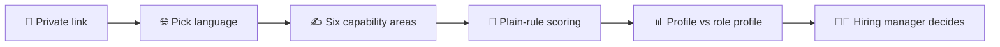
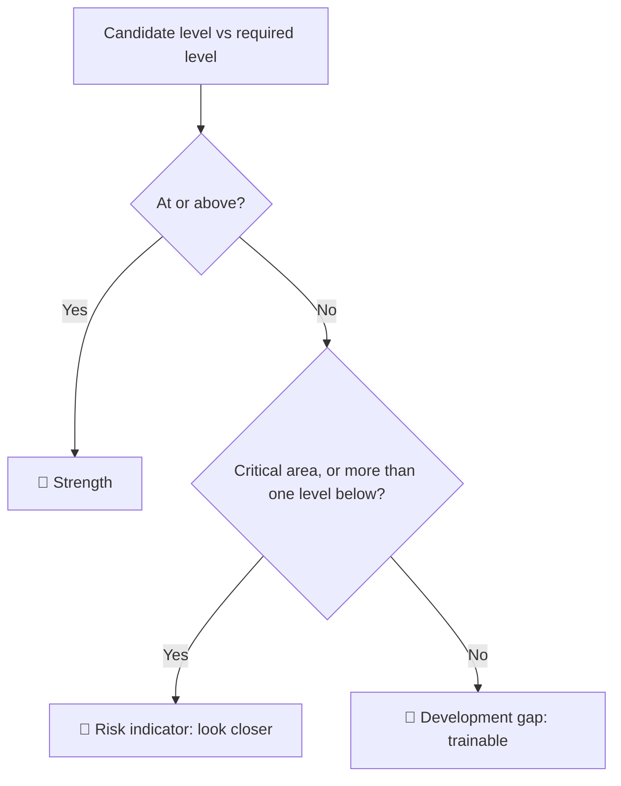
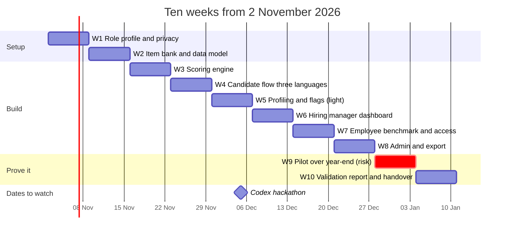
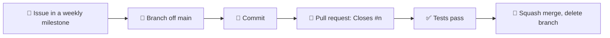

# 🧑‍💼 Front-Line Sales Candidate Assessment MVP

> 🎯 **Evidence, not a verdict.** A structured, three-language assessment that shows a hiring manager each candidate's strengths, development gaps and risks. The manager still decides.

⚠️ **Status:** shortlisted for interview on 2026-10-15. **Not awarded.** Everything below is the plan if the project is awarded. Issues here are planned work, not committed work.

## 📚 What is in this repo

| 📄 File | What it is |
|---|---|
| `PROPOSAL.pdf` / `PROPOSAL.md` | The submitted proposal. **It wins over every other doc.** |
| `KICKOFF.md` | Questions for the company, week 1 workshop, calendar risks |
| `INTERVIEW_PREP.md` | Likely questions and honest answers |
| `MARKET_SCAN.md` | Existing tools and open-source options, dated 2026-10-16 |
| `VIDEO_SCRIPT.md` | Pitch video script, problem first |
| `docs/PRD.md` | Product requirements, aligned with the proposal |
| `docs/user-flows.md` | Journey diagrams |

## 🧭 How a candidate becomes a profile

## 🚦 How a gap becomes a flag

The company agrees a **role profile** first: a required level per area, marked critical or trainable.

A risk indicator is a prompt to look closer. It is never a rejection.

## 🗓️ Plan if awarded

⚠️ Week 9 is the worst week of the year for a pilot. The plan is to run employee sessions in week 7 and start the candidate pilot in week 8. See `KICKOFF.md`.

## ✅ What we promise, and what we do not

| ✅ We promise | 🚫 We do not claim |
|---|---|
| 100% scoring accuracy on hand-scored sheets | That a score predicts job success |
| Every flag traces to the questions behind it | An automated hire or reject |
| Three reviewed languages, difficulty checked across them | That three languages are equal before the check runs |
| Benchmark shown as a range with group size | A correlation from about 10 employees |
| A validation report that says what is not proven | Psychometric certification |

## 🔄 How work moves

1. Every piece of work is a GitHub issue, attached to a weekly milestone.
2. Branch from `main`: `<type>/<issue>-<short-desc>`, for example `feat/10-scoring-engine`. Types: feat, fix, docs, chore.
3. Open a pull request that says `Closes #<issue>`. One issue per pull request.
4. Merge with squash once tests pass. Delete the branch.
5. No direct pushes to `main` after the first commit.
6. A change to someone else's document goes in a pull request they review before it merges.

## 🔒 Never commit

- 🙅 Real candidate or employee data, in any form, including screenshots.
- 🔑 Credentials or `.env` files.
- 🎬 Videos.
- 🧪 Test data must be synthetic.
