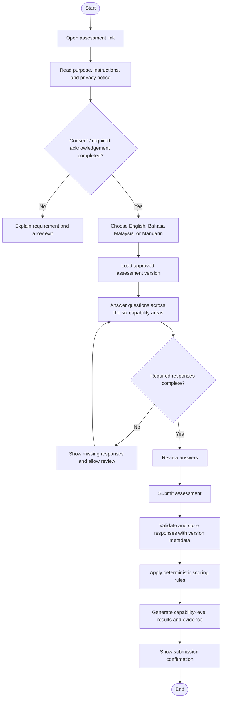
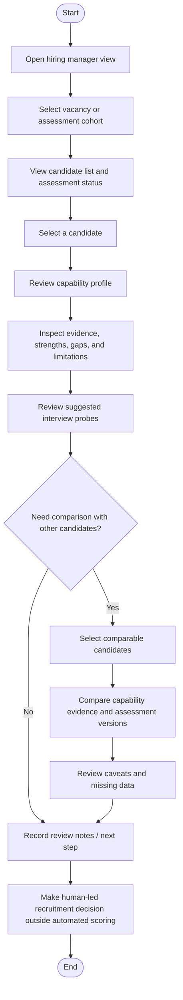
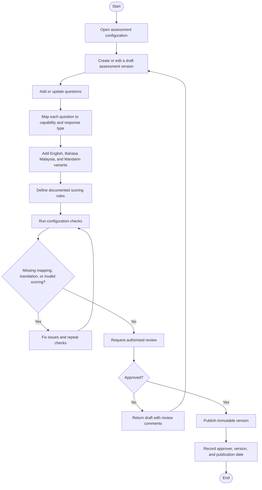
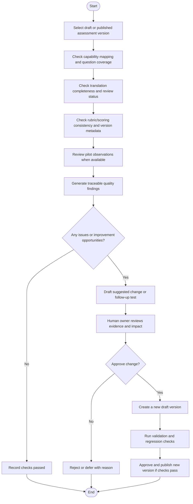
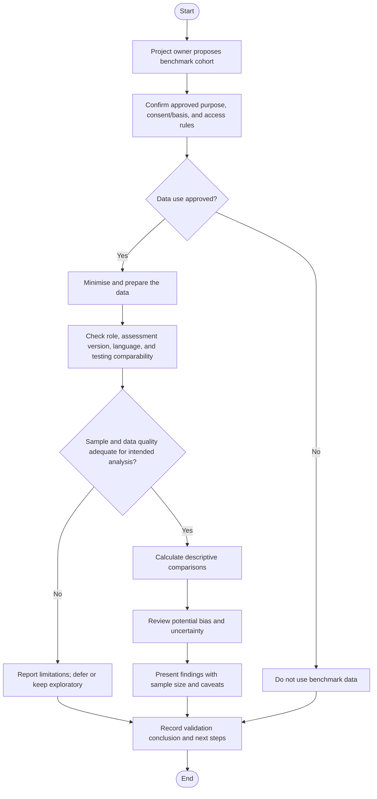

# User Flows
## DXP Front-Line Sales Candidate Assessment MVP

These flows describe the core MVP journeys. They intentionally focus on the product's business functions rather than generic login, registration, or account-management flows.

## 1. Candidate completes an assessment

**Notes**
- The exact consent and acknowledgement wording must be approved by the project owner.
- The candidate should know whether answers can be changed after submission.
- Store the language, question version, rubric/scoring version, and timestamps needed for auditability.
- Do not show a misleading “pass/fail” decision unless the project explicitly approves and validates such a use.

## 2. Hiring manager reviews a candidate

**Notes**
- Show when candidates completed different assessment versions or used conditions that make direct comparison unreliable.
- Interview probes should be linked to evidence or a capability gap, not invented as facts about a candidate.
- The tool supports decisions; it does not autonomously hire or reject candidates.

## 3. Authorised administrator manages assessment content

**Notes**
- Published versions should not be silently overwritten.
- Changes to questions, translations, or scoring should create a new version.
- The project owner must define who is authorised to approve and publish content.

## 4. Assessment harness checks quality and proposes improvements

**Notes**
- “Self-improving” means the system helps identify and manage quality improvements; it does not rewrite or publish questions without human approval.
- Every finding should identify the affected item, reason, severity or priority, and suggested next action.
- A pilot pattern from a small sample should be labelled uncertain rather than treated as proof.

## 5. Employee benchmarking and pilot validation

**Notes**
- Benchmarking is optional and gated by the project owner's approval and applicable privacy requirements.
- Similarity to current employees does not by itself prove future job performance.
- Do not report identifiable employee-level benchmark results to users who do not need that access.

## Flow-to-requirement traceability

| Flow | Related requirements |
|---|---|
| Candidate assessment | FR-01, FR-02, FR-03, FR-04, FR-10 |
| Hiring manager review | FR-05, FR-06, FR-07 |
| Content management | FR-03, FR-08, FR-09, FR-10 |
| Assessment harness | FR-08, FR-09, FR-10, FR-13 |
| Benchmarking and validation | FR-11, FR-13 and privacy/security requirements |

## Implementation boundary

These are proposed flows for review, not evidence that the functionality already exists. The team should confirm the exact candidate consent wording, scoring scales, approval roles, assessment length, data retention, and pilot criteria before implementation.
